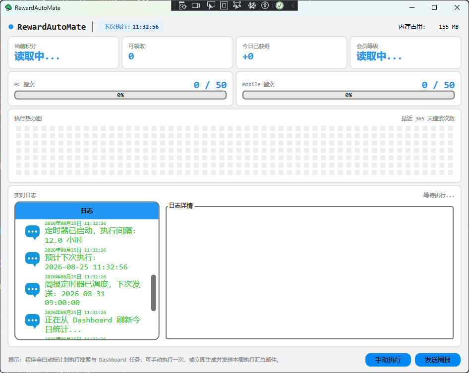

# RewardAutoMate

自动完成 Microsoft Rewards（Bing 搜索奖励）日常任务的 Windows 桌面工具，支持无人值守运行、执行历史持久化与邮件通知。

> ⚠️ 仅供学习与个人使用。自动化行为可能违反 Microsoft Rewards 服务条款，存在积分清零或账户受限的风险，请自行评估后使用。

## 📷 界面预览



## ✨ 功能特性

- **Bing PC / Mobile 搜索自动化**：随机词库、随机间隔、自然滚动、人类行为模拟
- **WebDriver 自动同步**：启动时自动检测 Edge 版本并下载匹配的 msedgedriver（`WebDriverUpdater`）
- **Rewards Dashboard 交互**：读取积分/等级/进度，自动领取福利、完成 Daily Set / Punch Cards / 日常任务
- **反检测**：CDP 脚本注入、Canvas/WebGL 指纹混淆、随机 UA 与窗口尺寸
- **执行历史持久化**：每次执行写入 SQLite（`RewardsHistory.db`），供事后查看与汇总
- **邮件通知**：异常即时报警（附堆栈与历史概况）、每周一 09:00 定时发送执行汇总
- **热力图可视化**：最近 365 天搜索次数可视化（`HeatMapData.db`）

## 🛠️ 技术栈

| 组件 | 说明 |
|------|------|
| .NET 8 + WPF | 桌面应用 |
| Selenium WebDriver | Edge 浏览器自动化 |
| SqlSugar | SQLite ORM |
| BaseTool / BaseWPFControl | 自研工具库（日志、通用函数、UI 控件） |

## 📦 目录结构

```
.
├── src/                        # 源代码
│   ├── RewardAutoMate.sln
│   └── RewardAutoMate/
│       ├── Configuration/      # 全局配置（AppConfig.cs）
│       ├── Logging/            # 日志封装（BaseLogManager）
│       ├── Models/             # 数据模型
│       ├── Services/           # 业务服务（搜索/Dashboard/邮件/历史/反检测…）
│       ├── External/           # 外部依赖 dll、驱动、邮件配置模板
│       └── ...
├── doc/                        # 文档
│   ├── 需求文档.md
│   ├── BaseTool与BaseWPFControl使用文档.md
│   ├── RewardsAutoMate代码分析报告.md
│   └── RewardsAutoMate优化计划.md
└── README.md
```

## 🚀 快速开始

**环境要求**：Windows 10/11 + [.NET 8 SDK](https://dotnet.microsoft.com/download/dotnet/8.0) + Microsoft Edge 浏览器

```bash
# 构建
dotnet build src/RewardAutoMate.sln

# 运行
dotnet run --project src/RewardAutoMate
```

**首次运行**：

1. 将 `src/RewardAutoMate/External/email_config.json.example` 复制为 `email_config.json` 并按需填写（可选，邮件通知需要）。
2. 先在 `Configuration/AppConfig.cs` 中设 `Headless = false`，启动程序完成一次 Edge 登录（登录状态保存在 `EdgeUserData`），之后可改回 `true` 无头运行。
3. 程序启动 30 秒后自动执行第一轮任务，之后按 `ExecuteIntervalHours`（默认 12 小时）周期运行。

## ⚙️ 配置说明

邮件配置 `email_config.json`（**不要提交真实授权码到仓库**）：

```json
{
  "sender": "your_email@qq.com",
  "auth_code": "你的QQ邮箱授权码",
  "smtp_server": "smtp.qq.com",
  "smtp_port": 587,
  "receiver": "your_receiver@163.com"
}
```

常用行为配置位于 `src/RewardAutoMate/Configuration/AppConfig.cs`：

| 配置项 | 默认值 | 说明 |
|--------|--------|------|
| `MaxPcSearches` / `MaxMobileSearches` | 50 / 50 | 每轮 PC/移动端搜索次数 |
| `ExecuteIntervalHours` | 12 | 执行周期（小时） |
| `Headless` | true | Edge 无头运行 |
| `EnableDashboardTasks` | true | 是否执行 Dashboard 任务 |
| `AutoUpdateWebDriver` | true | 按本机 Edge 版本自动同步 msedgedriver |
| `EnableDriverVerboseLog` | true | 驱动以 `--verbose` 启动，便于排查浏览器启动失败 |
| `NotifyOnFailure` | true | 异常邮件开关 |
| `SendWeeklyReport` | true | 每周汇总邮件开关 |
| `NotifyCooldownMinutes` | 30 | 相同异常邮件冷却时间 |

## 🧹 进程清理

浏览器与驱动进程会在这几个时机被清理，避免残留的 `msedge.exe` 占着 `EdgeUserData` 导致下次启动崩溃：

| 时机 | 行为 |
|------|------|
| 程序启动 | 结束上一次运行残留的（命令行带本项目 `EdgeUserData` 的）`msedge.exe` 与全部 `msedgedriver.exe`，并删除 `SingletonLock` / `DevToolsActivePort` 等锁文件 |
| 退出（托盘右键「退出」/ 注销关机/进程退出） | 先 `Quit()`（10 秒超时），再兜底结束残留进程 |
| 驱动升级前 | 先结束 `msedgedriver.exe`，再覆盖驱动文件（带 3 次重试） |
| 浏览器启动崩溃 | 清进程 + 删锁文件后重试，第 2 次关 GPU、第 3 次改用 `EdgeUserData.fallback` |

清理只针对**本项目 profile 的**浏览器进程，不会关闭用户自己开的 Edge 窗口。程序带单实例互斥锁，重复启动会提示而不会起第二个进程。

## 📬 邮件通知

| 邮件 | 触发时机 | 内容 |
|------|---------|------|
| 异常通知 | 搜索/流程/浏览器异常 | 异常类型、时间、堆栈、账户状态、近 7 天执行概况 |
| 每周汇总 | 每周一 09:00（未发才发，周一 09:00 后启动会补发） | 本周执行/成功失败、真实积分增长、按天概况、本周异常 |

## 🖥️ 服务器部署（无人值守）

1. `AppConfig.cs` 中保持 `Headless = true`。
2. 通过任务计划或开机自启拉起进程（关闭窗口即最小化到托盘，不会退出）。
3. 日志：`Logs/yyyy-MM-dd.log`（保留 30 天）+ `Logs/LogOnSaveSQLite.db`；执行历史：`RewardsHistory.db`。
4. 建议使用 Windows Server + RDP 会话保持程序常驻。

## 📝 开发文档

详细文档见 `doc/` 目录，包括需求、代码分析、优化计划与 BaseTool/BaseWPFControl 使用指南。

## 📄 许可证

[MIT](LICENSE)
